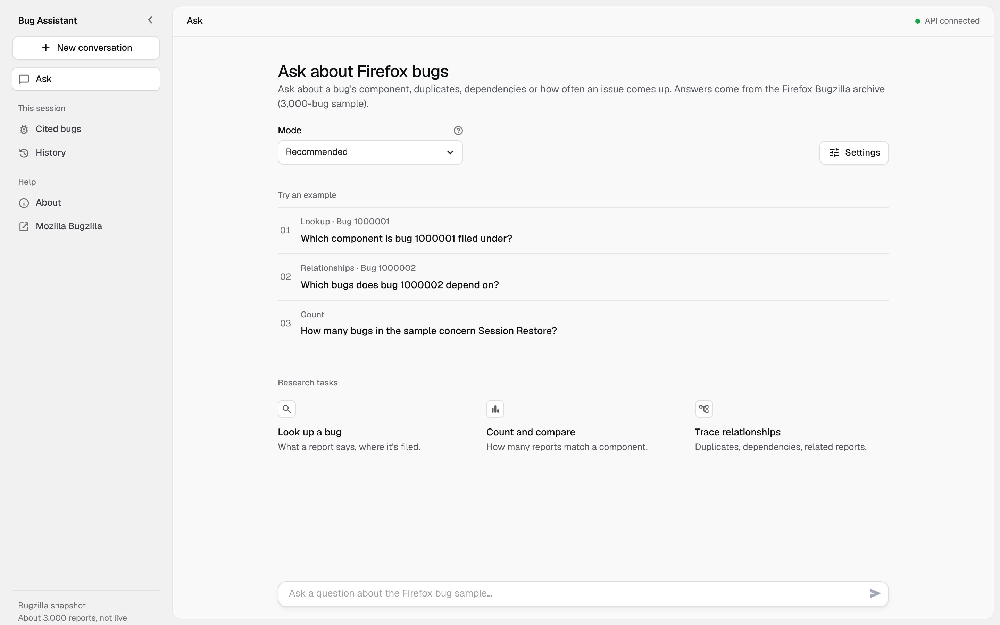
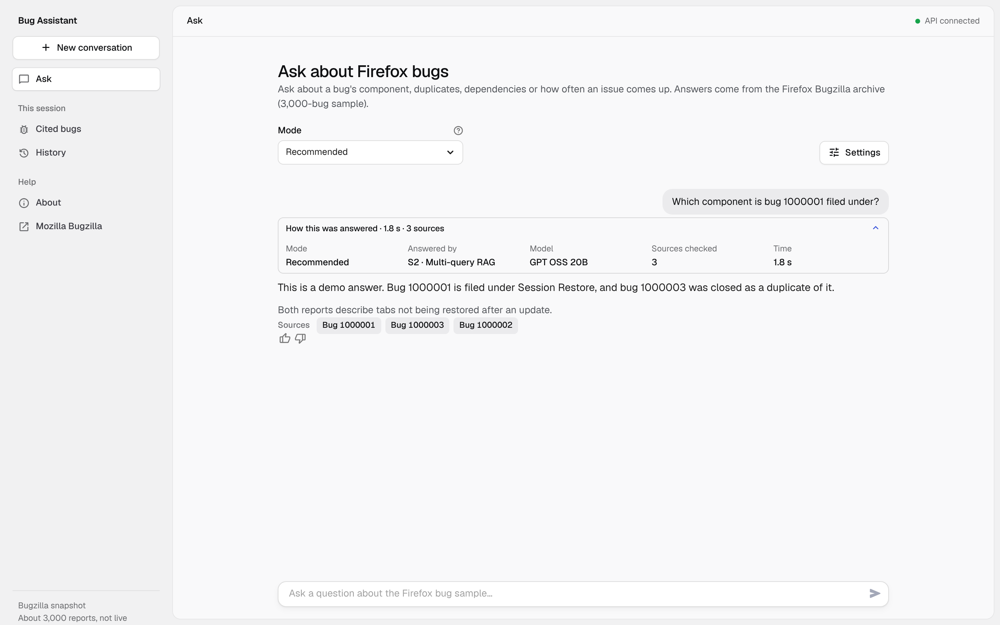
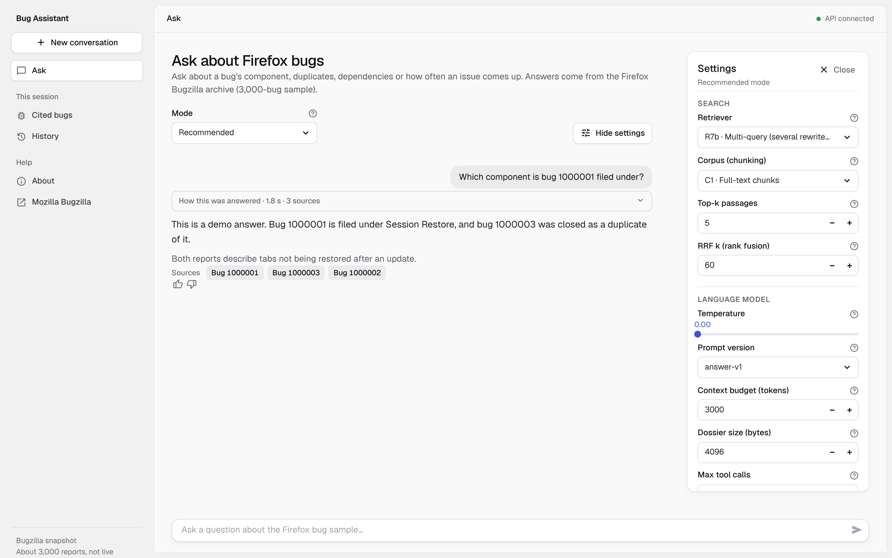
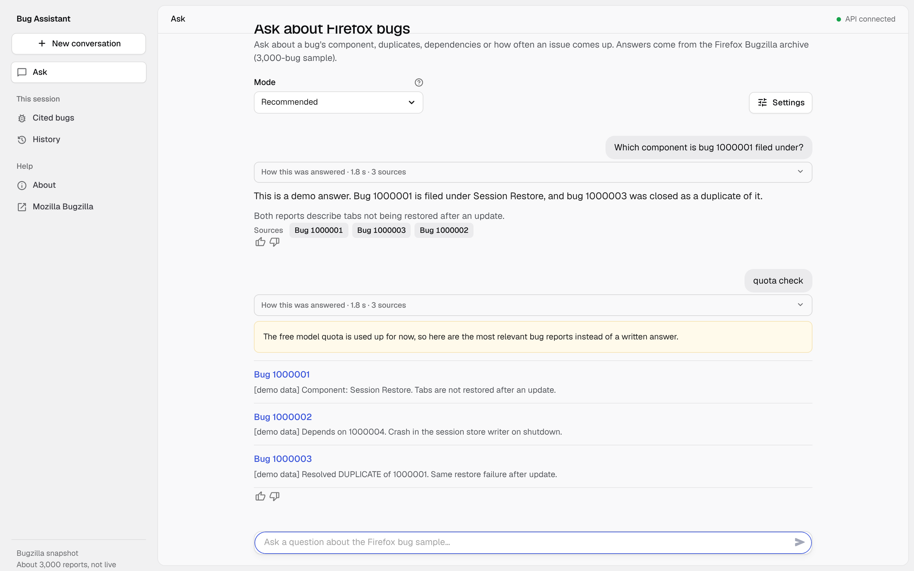
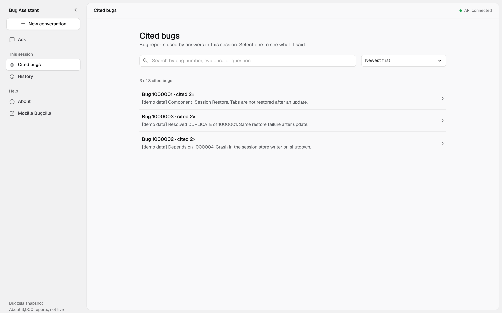
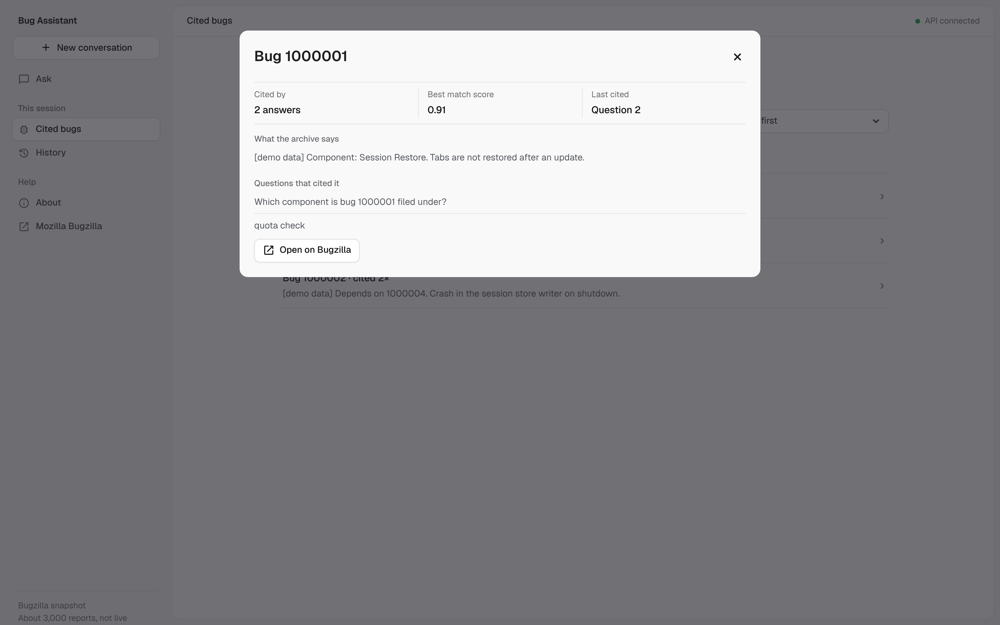
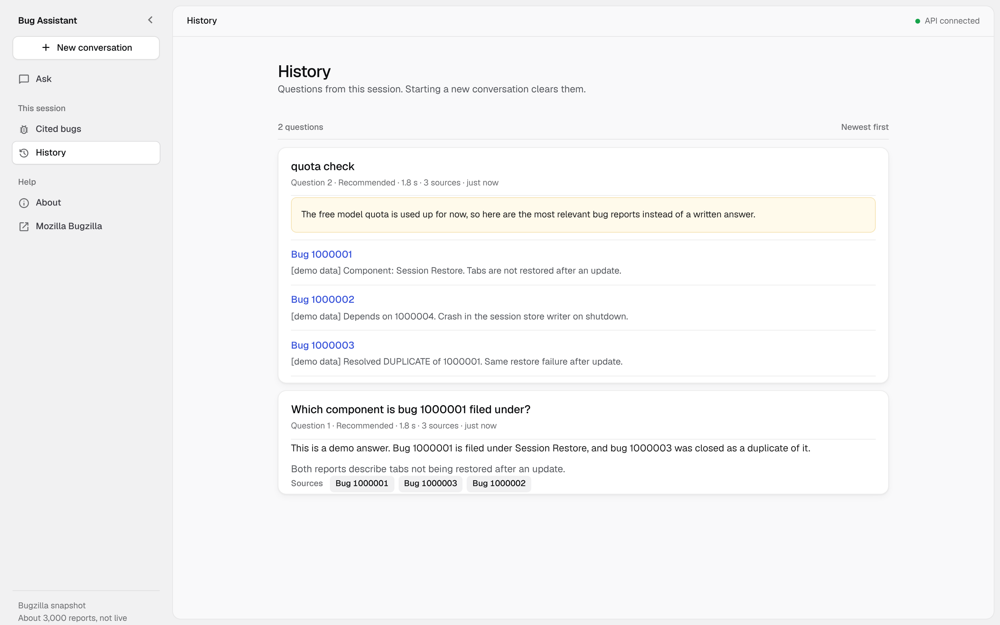

# Chat UI: Firefox Bug Assistant

A Streamlit chat app for asking questions about the saved Firefox bug archive. It talks **only**
to the serving API (`/v1`, Stream A). It never imports torch or the research code, and the
API key stays on the server.



| Answer with sources | Settings panel | Sources-only fallback |
|---|---|---|
|  |  |  |

| Cited bugs | Bug details popup | History |
|---|---|---|
|  |  |  |

## Run it

From the repo root, in the conda `iqfm` env:

```powershell
pip install -e ".[ui]"                               # or just streamlit and httpx
streamlit run src/bugzilla_serving/chat_ui/app.py    # http://localhost:8501
```

It reads `API_URL` (default `http://127.0.0.1:8000`) and `SERVING_API_KEY` from the environment
or from the repo-root `.env`, the same file the API uses. The API must be running on port 8000:
`uvicorn bugzilla_serving.api.app:app --port 8000`. Run Streamlit from the repo root, because
that's where it finds the theme in `.streamlit/config.toml`.

**No backend handy?** Start the offline mock instead. It returns demo data and made-up bug numbers:

```powershell
$env:SERVING_API_KEY = "dev-key"
python tests/a_ui/ui_mock_api.py                     # terminal 1, port 8000
streamlit run src/bugzilla_serving/chat_ui/app.py    # terminal 2, same SERVING_API_KEY
```

Try these questions against the mock to see the other states: *"quota"* (sources-only),
*"unknown"* (no answer), *"slow down"* (rate limited) and *"broken"* (error).

## Design rules

The look follows kapa.ai's app: a grey frame with the page in a raised pane, quiet grey text
hierarchy, hairlines instead of cards, and one blue accent. It should read as a working tool,
not a landing page.

- **Frame.** Canvas `#F1F1F2` (sidebar and border around the pane), pane `#F9F9FA` with a 1px
  hairline and 12px corners, white (`#FFFFFF`) for inputs, cards and the current nav item.
- **One font.** Geist, self-hosted in `chat_ui/static/fonts` (system UI font as fallback). Weights 400,
  500 (headings, labels) and 600 (brand only).
- **One type scale.** 24px page title (500, -0.025em), 16px section, 14px body and controls,
  15px answer text, 13px secondary, 12px metadata and labels.
- **Text colours.** `#0E0F11` headings, `#1E1E1E` answers, `#56595E` descriptions, `#6B6C6F`
  metadata. All meet WCAG AA (lowest is 4.6:1, metadata on the grey sidebar).
- **One accent.** `#3853DA` for links, focus and the primary button. Status colours appear only
  in the API dot and warnings.
- **Structure.** One heading per page, a thin top bar with the page name and API status,
  grouped sidebar navigation, numbered example rows, task tiles with a hairline on top, and a
  collapsed "How this was answered" box above each answer (mode, which system answered, model,
  sources, time). No emoji, no hero.
- **Settings in a side panel.** The Settings button opens a panel on the right of the chat,
  like a model playground's run settings, grouped into Search and Language model. Names use the
  usual terms (Retriever, Corpus, Top-k, Temperature) and each R/C/S code says what it is
  (`chat_ui/ui/labels.py`). Changes are kept when the panel closes.
- **Lists open details.** Cited bugs is a list of rows; selecting one opens a popup with what
  the archive said and which questions cited it. History shows each question as a card.
- Tokens live in `.streamlit/config.toml` (theme) and the top of `chat_ui/assets/styles.css`. Change them
  there instead of styling single elements.

## How the code is organised

```
.streamlit/config.toml        theme (colours, Geist, static file serving)
src/bugzilla_serving/chat_ui/
├── app.py                    entry point: page setup, sidebar, navigation
├── config.py                 settings from env / .env (API_URL, SERVING_API_KEY)
├── api/
│   ├── client.py             HTTP + SSE client, one error type (ApiError)
│   └── models.py             typed views of the API JSON (Preset, AnswerRecord, …)
├── chat.py                   the "ask a question" use case; no Streamlit, easy to test
├── state.py                  typed per-session state (turns, rate limit, notices)
├── ui/
│   ├── data.py               cached API access (catalog 5 min, quota 15 s)
│   ├── components.py         display-only pieces: answer, source chips, header
│   └── controls.py           inputs: mode picker, advanced settings, feedback
├── pages/                    one module per screen, each with render()
├── assets/styles.css         layout and type scale the theme can't set
└── static/fonts/             Geist, served by Streamlit's static file serving
tests/a_ui/
├── ui_mock_api.py            offline API that follows the real contract
└── test_ui_*.py              pytest + Streamlit AppTest, no network
```

The chat UI needs only the `[ui]` extra (Streamlit and httpx). It never imports the API, torch
or the research code.

The layers only call downwards: **pages → ui → chat → api**. Only `api/` knows about HTTP, and
only `ui/` and `pages/` know about Streamlit. That keeps each part small and testable.

## API it uses

| Endpoint | Client method | Used for |
|---|---|---|
| `GET /v1/ready` | `is_ready()` | Online/offline status; questions pause when it fails |
| `GET /v1/options` | `options()` | Answer modes (presets), advanced settings, model labels |
| `GET /v1/presets` | `presets()` | The answer modes on their own |
| `GET /v1/examples` | `examples()` | Example questions on the welcome screen |
| `GET /v1/quota` | `quota()` | Banner when the free quota is nearly used up |
| `POST /v1/chat/stream` | `stream(body)` | The answer, with live progress (SSE); what the chat uses |
| `POST /v1/ask` | `ask(body)` | The same answer in one response, without progress |
| `POST /v1/feedback` | `feedback()` | Thumbs up/down and an optional comment |

`client.chat_body(...)` builds the request body for `stream()` and `ask()`. The catalog
(`options` plus `examples`) is cached for 5 minutes (`ttl=300`).

Each question is sent on its own (`session_id`, `message`, `preset_slug`, `overrides`). Only
settings that differ from the selected mode are sent as `overrides`.

## Tests

```powershell
pip install -e ".[ui,dev]"
pytest tests/a_ui        # or: pytest -m ui
ruff check .
```

`tests/a_ui/test_ui_contract.py` checks the mock against the real pydantic models in
`bugzilla_serving.contracts`, so if the API contract changes, the tests fail instead of the UI.

`tests/a_ui/test_ui_app.py` covers the empty state, a normal answer, abstention (closest
reports), degraded mode (sources only), rate limiting and a rejected Advanced setting shown under
its field. `tests/a_ui/test_ui_pages.py` renders Cited bugs, History and About with seeded
answers.
