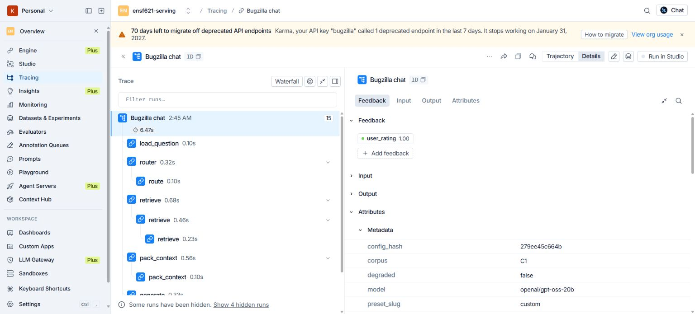
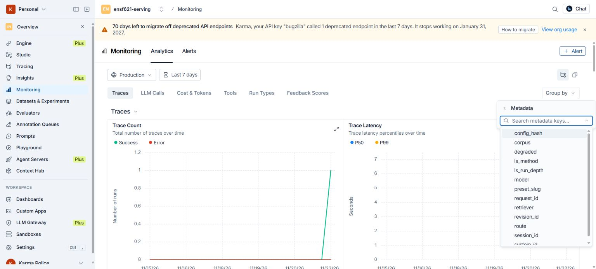

# Serving traces and feedback

The API samples requests into `ensf621-serving`. The default is 20%, with a
SQLite-backed cap of 150 trace attempts per UTC day. Restarting the API does not
reset that cap. No key means no tracing; answering and local feedback still work.
This cap covers this service, not other projects in your LangSmith account.

Each sampled request has one root trace, with the research graph as child runs.
Our metadata has exactly the ten fields agreed in `contracts/names.py`:
`config_hash`, `preset_slug`, `system_id`, `model`, `retriever`, `corpus`, `route`,
`degraded`, `request_id`, `session_id`. LangSmith also adds its own SDK fields.
User overrides label the preset `custom`; otherwise it uses the selected preset slug.
Quota fallback records the effective R0 configuration and `degraded=true`.

Inputs, outputs, metadata, feedback comments and SDK write payloads redact known
credential values from `.env` and the environment. Environment contents are never
attached to traces. Keep real keys only in the ignored `.env`.

## Find and compare requests

1. Open LangSmith and select `ensf621-serving`, then **Tracing**.
2. Open a `Bugzilla chat` trace. **Attributes → Metadata** contains the fields above;
   **Feedback** shows `user_rating` (1 for thumbs-up, 0 for thumbs-down).
3. In **Monitoring → Analytics**, select the serving environment and time range.
   Use **Group by → Metadata** to compare `preset_slug`, `model` or `degraded`.
4. For a filtered custom chart, choose the serving environment and add a **Metadata**
   filter: `preset_slug = fast` (or `custom`), `model = openai/gpt-oss-20b`, or
   `degraded = true`. Select root/trace filtering to count messages rather than child
   runs. The newer custom-dashboard UI calls these **Filter & group** controls.
5. The Feedback Scores section charts `user_rating`. Aggregates can lag behind the
   trace detail view. One mock trace verifies wiring, not model answer quality.

See the [official monitoring guide](https://docs.langchain.com/langsmith/dashboards)
for the current chart controls; their layout varies between dashboard versions.

These screenshots were captured from the live check on November 22, 2026.





## Final checks

From the repo root, with `iqfm` active, run the offline checks:

```powershell
python -m pytest tests/a_tracing tests/a_quota tests/a_api tests/a_bundle tests/contracts tests/test_answering_graphs.py tests/test_retrieval_v3.py -q
```

For one live verification, set these entries in `.env`, preserving your other settings:

```dotenv
BUNDLE_DIR=serving_bundle
SERVING_API_KEY=your_local_api_secret
LANGSMITH_API_KEY=your_real_langsmith_key
LLM_PROVIDER=mock
TRACE_SAMPLE=1
TRACE_DAILY_CAP=150
```

Start the API in one terminal:

```powershell
python -m uvicorn bugzilla_serving.api.app:app --host 127.0.0.1 --port 8000 --workers 1
```

In another terminal, preview the check, then explicitly run it:

```powershell
python scripts/check_serving_tracing.py
python scripts/check_serving_tracing.py --live
```

The live command submits exactly one mock question and one thumbs-up, then reads
LangSmith to verify the project, required metadata, request ID and feedback. It uses
no Groq requests. Because it explicitly overrides the provider, the trace's preset
label is `custom`. A mock generation still counts as one `llm_calls` in the engine
record; this is not a real model API call.

Success prints `COMPLETE` and saves the verified trace URL in the ignored
`outputs/serving/a4_live_check.json`. Follow that URL and inspect the metadata and
feedback. An unsampled response has `langsmith_run_id=null`; a non-null ID alone is
not proof of remote ingestion, which is why the check reads LangSmith afterward.
Afterward, restore `TRACE_SAMPLE=0.2` and restart the API.

Every feedback submission is saved with its time in
`outputs/serving/feedback.sqlite`. `remote_status` is `local` for untraced requests,
`sent` after successful remote feedback, or `pending` if remote submission failed.
Resubmit the feedback after connectivity returns; the local copy is retained.

The November 22 live check confirmed one root with 15 child runs, all ten required
metadata fields, and `user_rating=1`. The UI also displayed a deprecated-endpoint
notice for the pinned SDK; review that migration before January 31, 2027 rather
than changing the shared dependency pins during this step.
