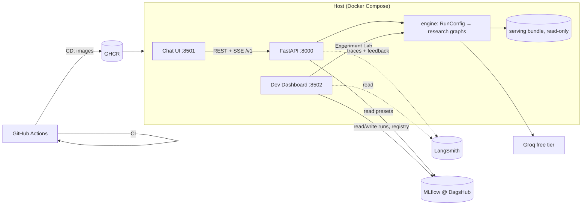

# ENSF 621 MLOps: System Behaviour, Shared Contracts and Work Split

This is the single source of truth for the `mlops` branch. Two people build it in parallel:
- **Stream A**, Serving & Chat: `mlops_stream_a_serving_chat.md`.
- **Stream B**, Experiments & Dev Dashboard: `mlops_stream_b_experiments_dashboard.md`.

The streams share nothing except the **contracts** in section 4. Those are frozen in Phase 0 and changed only with both people's approval. One integration step at the end ties the streams together (section 6).

---

## 1. What the system does

A retrieval-based chatbot for Firefox bug history, with two front ends.

| | **Chat UI** (user-facing) | **Dev Dashboard** (team, graders) |
|---|---|---|
| Who | Anyone with the link | Us, the instructor, graders |
| Purpose | Ask questions, get grounded answers with citations | Show the evaluation results for every system and let us configure and run experiments |
| Optimized for | Speed, clarity, no jargon, mobile-friendly | Information density, comparisons, honesty about n and gaps |
| Talks to | FastAPI service only | MLflow (+ LangSmith read-only), plus the shared engine for experiment runs |
| Owner | Stream A | Stream B |

### User journeys

**End user (Chat UI)**
1. Opens the chat and sees a short intro, 3–4 example questions and a **mode picker** with friendly names, e.g. "Recommended", "Fast", "Deep read". Each mode is a **preset** published from MLflow.
2. Optionally opens **Advanced settings**: model, retriever, corpus, top-k, temperature, context budget, plus a few system-specific knobs. Each has a plain-language tooltip and a valid range. Changing anything shows "Custom settings" and a reset button.
3. Asks a question. While it waits it sees live progress: *Searching archive… Found 5 sources… Writing answer…*
4. Gets an answer card with:
   - the answer, or a friendly "I couldn't find enough evidence" when the system abstains;
   - citation chips (bug #, snippet, link to bugzilla.mozilla.org);
   - a small "How this was answered" expander (mode, model, sources, time);
   - 👍/👎 with an optional comment.
5. If the free quota is exhausted, it still gets the top sources, with a notice that the answer text is unavailable right now. That is retrieval-only mode (R0).

**Team / grader (Dev Dashboard)**
1. **Overview:** current champion, leaderboard by question family (with n), and the dataset coverage gaps.
2. **Answer eval:** per-family scores per system from the partner's evaluation, with intervals where available.
3. **Retrieval eval:** R1–R7 × C0–C2 metrics.
4. **Cost & latency:** calls, tokens, p50/p95.
5. **Error analysis:** failure categories and sample dev predictions.
6. **Experiment Lab:**
   - pick a model and hyperparameters with the same widgets as the chat's Advanced settings;
   - see a budget preflight;
   - run on a small dev eval set;
   - the run is logged to MLflow and appears on the leaderboard.
7. **Compare runs:** pick 2–3 MLflow runs; see params side by side and per-family deltas.
8. **Presets:** publish a run's config as a chat mode or as champion. This goes through the MLflow registry, with confirmation.
9. **Production:** chat usage, feedback rate and latency by preset, read from LangSmith.

### The loop that connects them

```
Partner's eval + retrieval eval ──backfill──▶ MLflow runs ──▶ Dashboard leaderboard
Experiment Lab (hyperparams) ───────────────▶ MLflow runs ──┘
                     publish preset / champion (MLflow registry aliases + tags)
                                         ▼
                     FastAPI reads presets ──▶ Chat mode picker
Chat answers + 👍/👎 ──▶ LangSmith traces + feedback ──▶ Dashboard "Production" page
```

## 2. Architecture



- **FastAPI** (A): the only thing the Chat UI calls. It runs the engine with quota guard, tracing and feedback.
- **engine** (Phase 0, then A maintains): `RunConfig` → existing `bugzilla_qa` LangGraph systems. Both the API and the Experiment Lab use it, so chat answers and experiment results come from identical code.
- **MLflow on DagsHub** (B writes; A reads presets): a free hosted tracking server and registry.
- **LangSmith** (A writes; B reads): traces, user feedback and monitoring.
- **GitHub Actions:** CI (B), CD (A). **Hosting** (A): one Compose stack on an Oracle Always Free VM, or your own PC plus a Cloudflare Tunnel.

## 3. Free-tier constraints both streams must respect

- **Groq:** limits are per org **and per model**. gpt-oss-20b ≈ 30 RPM, 1K RPD, **8K tokens/min**, 200K tokens/day.
  - That is about 2 RAG answers/minute per model, and a 20-question experiment uses roughly 40% of one model's daily tokens.
  - Every model's limits live in `configs/serving.yaml`; context budgets are capped per model (S5's 12K dossier does not fit 8K TPM).
- **LangSmith:** 5K traces/month. Serving samples traces (default 0.2); experiments are not traced by default.
- **DagsHub free:** private-repo limits, so use few MLflow experiments with many runs.
- **GitHub Actions:** unlimited on public repos, 2,000 min/month on private.
- **Hosting:** HF Docker Spaces need a paid plan and Render free is 512 MB, too small; hence Oracle A1 (2 OCPU / 12 GB ARM) or own PC + Cloudflare Tunnel.
- **On the deployed host the Experiment Lab is read-only** (`DASHBOARD_LAB_ENABLED=false`), so public visitors can't spend quota.

## 4. Shared contracts (frozen in Phase 0)

### 4.1 Repo layout and ownership

| Path | Owner |
|---|---|
| `src/bugzilla_serving/contracts/` (RunConfig, schemas, hash, MLflow/LangSmith names) | **Shared**, needs both approvals |
| `src/bugzilla_serving/engine.py` | Phase 0, then **A** (changes need B's review) |
| `configs/serving.yaml` (models, limits, hyperparameter specs) | **Shared** |
| `src/bugzilla_serving/api/`, `bundle.py`, `quota.py`, `tracing.py` | A |
| `src/bugzilla_serving/chat_ui/` | A |
| `src/bugzilla_serving/tracking/`, `experiments/`, `dashboard/` | B |
| `scripts/build_serving_bundle.py`, `scripts/seed_*` | A (bundle), Phase 0 (seeds) |
| `scripts/backfill_*.py`, `scripts/run_experiment.py`, `scripts/publish_preset.py` | B |
| `docker/api.Dockerfile`, `docker/chat.Dockerfile`, `compose*.yaml`, `.github/workflows/cd.yml`, `docs/DEPLOYMENT.md` | A |
| `docker/dashboard.Dockerfile`, `.github/workflows/ci.yml`, `.github/dependabot.yml`, `pyproject` test/lint config | B |
| `tests/contracts/`, `tests/fixtures/` | Shared |
| `tests/a_*/` and `tests/b_*/` | Each stream's own tests |
| Research code `src/bugzilla_qa/` | **Nobody changes it** |

Git: integration branch `mlops`; feature branches `a/*` and `b/*`; PRs into `mlops` with CI required. `CODEOWNERS` requires both people on `contracts/`, `configs/serving.yaml` and `engine.py`.

### 4.2 RunConfig and hyperparameters

`contracts/run_config.py` (pydantic v2) holds:
- `RunConfig`: `system_id`, `retriever`, `corpus`, `provider`, `model`, `top_k`, `temperature`, `context_budget_tokens`, `prompt_version`, plus system-specific knobs (e.g. `s4_tau`, `s5_dossier_budget`, `s7_max_tool_steps`, `rrf_k`, `query_transform`).
- `config_hash(cfg)`: first 12 hex of sha256 of canonical sorted JSON. Used as the identity in MLflow, LangSmith and logs.
- `validate_against(spec)`: uses the specs in `configs/serving.yaml`.

`configs/serving.yaml → hyperparameters:` has one entry per knob: `type`, `min`/`max` or `choices`, `default`, `label`, `help` (plain language), `applies_to` (system IDs) and `advanced: true|false`. **Both UIs render their widgets from this file**, so the chat's Advanced settings and the dashboard's Experiment Lab always match. Only knobs the research graphs actually honour are listed; Phase 0 checks each one.

`configs/serving.yaml → models:` has `provider`, `model_id`, `label`, `rpm`, `rpd`, `tpm`, `tpd` and `max_context_tokens` per model.

### 4.3 Engine interface

```python
build_runner(cfg: RunConfig, provider=None) -> Runner
Runner.run(question: str, on_event=None) -> AnswerRecord
```

- `AnswerRecord`: `answer` (abstain, answer, answer_type, bug_ids, citations, rationale), `route`, `route_rule`, `evidence[]` (chunk_id, bug_id, snippet, score, url), `tokens`, `llm_calls`, `cache_hits`, `latency_ms`, `degraded`, `errors`, `config_hash`.
- `on_event` receives `status` events in the order `retrieving` → `retrieved(n)` → `generating` → `done`.
- `provider` defaults to the configured one; tests pass `MockProvider`.

### 4.4 API contract (A implements; Chat UI and integration tests rely on it)

| Endpoint | Contract |
|---|---|
| `GET /v1/health`, `GET /v1/ready` | `{status}`; ready only when the bundle, indexes and weights are loaded |
| `GET /v1/options` | Models (labels + limits), hyperparameter specs, presets list |
| `GET /v1/presets` | `[{slug, label, description, config, is_champion}]` from the MLflow registry (YAML fallback) |
| `GET /v1/examples` | Dev example questions (text only) |
| `POST /v1/chat/stream` | Body `{session_id, message, preset_slug?, overrides?}`. **SSE events:** `status {stage, detail}`, `evidence {items[]}`, `answer {AnswerRecord}`, `error {code, message}`, `done {request_id, langsmith_run_id?}` |
| `POST /v1/ask` | Same body, non-streaming, returns `{request_id, record: AnswerRecord, langsmith_run_id?}` |
| `POST /v1/feedback` | `{request_id, score: 0/1, comment?}` |
| `GET /v1/quota` | Per model: used/limit today, `degraded_now` |

Error codes: `invalid_config` (422), `rate_limited` (429 + `retry_after`), `internal`. The OpenAPI JSON is snapshotted in `tests/contracts/openapi.json`.

### 4.5 MLflow conventions (B writes; A reads)

- **Experiments:** `research-answer-eval`, `research-retrieval-eval`, `playground`.
- **Run params:** every RunConfig field + `config_hash`.
- **Required tags:** `source` (backfill|lab|ci), `eval_set`, `datasets`, `split` (dev|test-aggregate), `scorer`, `git_sha`.
- **Metric names:**
  - answers: `answer.<FAMILY>.score`, `answer.<FAMILY>.n`, `answer.macro`;
  - abstention and failures: `abstain.correct_rate`, `abstain.false_rate`, `fail.rate`;
  - cost and latency: `cost.llm_calls`, `cost.tokens_in`, `cost.tokens_out`, `latency.p50_ms`, `latency.p95_ms`;
  - retrieval: `retr.<DATASET>.<FAMILY>.<metric>` (e.g. `retr.v3.KI.recall_at_10`).
- **Artifacts:** `config.yaml`, `per_family.csv`, `predictions.jsonl` (dev only).
- **Registry:**
  - registered model `bugzilla-qa-config`; each version is a pyfunc wrapper whose artifact is `config.yaml`;
  - alias `champion`;
  - **presets** = versions tagged `preset_slug`, `preset_label`, `preset_description`, `published=true`.
- Test results, once they exist, are logged **only as aggregate metrics** with `split=test-aggregate`, never with questions or gold.

### 4.6 LangSmith conventions (A writes; B reads)

- **Projects:** `ensf621-serving` (chat) and `ensf621-dev` (optional experiment traces).
- **Root run metadata:** `config_hash`, `preset_slug` (or `custom`), `system_id`, `model`, `retriever`, `corpus`, `route`, `degraded`, `request_id`, `session_id`.
- **Feedback key:** `user_rating` (0/1), with `comment`.

### 4.7 Runtime conventions

- **Ports:** api 8000, chat 8501, dashboard 8502.
- **Images:** `ghcr.io/<owner>/bugzilla-{api,chat,dashboard}:<tag>`.
- **Env vars:**
  - provider and observability: `GROQ_API_KEY`, `LANGSMITH_API_KEY`;
  - MLflow: `MLFLOW_TRACKING_URI`, `MLFLOW_TRACKING_USERNAME`, `MLFLOW_TRACKING_PASSWORD`;
  - serving: `SERVING_API_KEY`, `API_URL`, `LLM_PROVIDER` (groq|mock), `BUNDLE_DIR`;
  - dashboard: `DASHBOARD_PASSWORD`, `DASHBOARD_LAB_ENABLED`.
- **Tests:**
  - pytest markers `unit`, `contract`, `ui`, `integration`, `live`; CI runs `-m "not live and not integration"` plus the compose smoke;
  - no live calls in CI;
  - coverage ≥70% per stream package.
- **Hard rules:** dev data only (never test questions or gold); no secrets in code, logs, images, MLflow or traces; research code untouched.

## 5. Phase 0: contracts and stubs (½–1 day, before splitting)

Done by one person, reviewed and approved by the other. Deliverables:
1. `contracts/` package and `configs/serving.yaml`, with each hyperparameter checked against what the research graphs actually accept.
2. `engine.py` thin adapter + a MockProvider test that runs every system on a synthetic fixture.
3. `tests/fixtures/`:
   - a tiny **synthetic** serving bundle (about 20 fake bugs, indexes, about 10 dev questions);
   - sample SSE event and `AnswerRecord` JSON;
   - a sample LangSmith feedback/run export;
   - a sample partner eval output.
4. `scripts/seed_mlflow_fixture.py`: creates a local file-based MLflow store with 3 fake runs, a champion and 2 presets. A uses it before B's real backfill exists.
5. `tests/contracts/` tests both streams must keep green: RunConfig validation, hash stability, OpenAPI snapshot (initially a stub app), MLflow naming checker, LangSmith metadata checker.
6. `CODEOWNERS`, `.env.example`, empty package skeletons per the ownership table, and the minimal `pyproject` deps.

Once Phase 0 is merged into `mlops`, **A and B never need each other's code until integration**. Each develops against the fixtures and stubs.

## 6. Integration (one session at the end, ~1 day)

1. Merge `a/*` and `b/*` into `mlops`; resolve anything in shared files.
2. Point A at the real MLflow (DagsHub) and check the chat mode picker shows B's published presets and champion.
3. **Parity test:** for the champion config, an Experiment Lab run and the `/v1/ask` answer are identical on 3 dev questions (MockProvider + real bundle).
4. Ask in the chat, give 👍, and check that it appears on the dashboard's Production page.
5. Compose with all three services (fixture bundle + mock) passes the smoke in CI; add the compose smoke job to `ci.yml`.
6. CD: tag `v0.1.0`, deploy all three images to the host, and run the post-deploy smoke (R0 query, zero LLM quota). Lab disabled on the host.
7. README "MLOps" section, a demo script, and the screenshots.

## 7. Timeline (about 5 working days)

| Day | Stream A | Stream B |
|---|---|---|
| 0 | Phase 0 together (½–1 day) | |
| 1 | Serving bundle, API core, quota, SSE | MLflow setup, backfill answer + retrieval evals |
| 2 | Chat UI | Experiment runner + Experiment Lab, publish presets |
| 3 | LangSmith tracing/feedback, Docker, Compose, CD, host setup | Dashboard pages, Production page (LangSmith read), CI workflow, dashboard Dockerfile |
| 4 | Integration (together) | |
| 5 | Deploy, demo prep (together) | |

## 8. Definition of done (demo checklist)

- Chat UI deployed: modes from MLflow presets, Advanced settings, streaming progress, citations, friendly abstention, degraded R0 mode, feedback.
- Dashboard deployed (read-only): leaderboard per family with n, retrieval/answer/cost/error pages, compare runs, Production page; Experiment Lab demoed locally.
- MLflow: backfilled research runs, ≥1 Lab run, champion + presets in the registry.
- LangSmith: serving traces with metadata, feedback, monitoring charts.
- GitHub Actions: green CI on a PR; CD deploy from a tag; one rollback shown.
- Parity test green.
